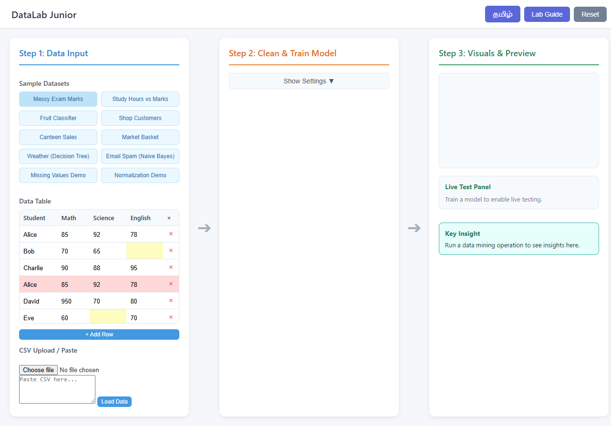
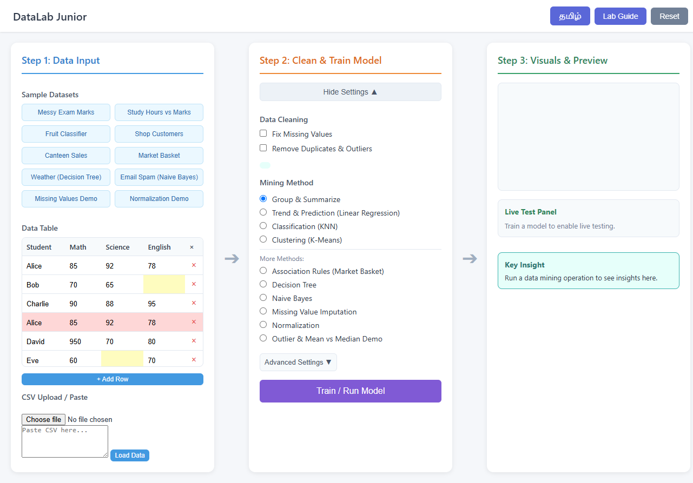
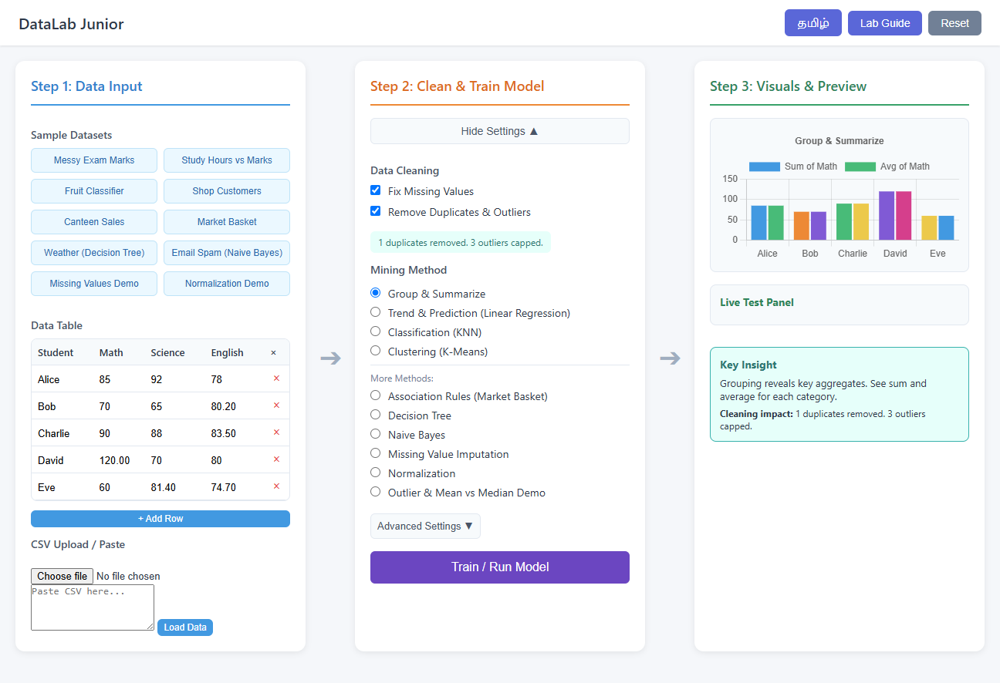

# 📝 DataLab Junior — பயிற்சி தட்டங்கள் (Lab Exercises Workbook)

> **20 மாதிரி பயிற்சிகள் மாணவர்களுக்கான நடைமுறை கையேடு**  
> டேட்டா அறிவியல் & டேட்டா மைனிங் சிமுலேட்டர்

---

## 📋 பயிற்சி தட்டங்கள் சுருக்கம்

| # | பயிற்சி | டேட்டாசெட் | முறை |
|---|---|---|---|
| 1 | விடுபட்ட மதிப்புகளை சரிசெய்தல் | Messy Exam Marks | Cleaning |
| 2 | இரட்டிப்பு & வெளிப்புற மதிப்பு நீக்கல் | Messy Exam Marks | Cleaning |
| 3 | சுத்திகரிப்பு முன்/பின் ஒப்பீடு | Messy Exam Marks | Cleaning + Group |
| 4 | நேரியல் பின்னோக்கி | Study Hours vs Marks | Trend & Prediction |
| 5 | நேரடி கணிப்பு சோதனை | Study Hours vs Marks | Trend & Prediction |
| 6 | பல தரவுகளுடன் கணிப்பு | சொந்த CSV | Trend & Prediction |
| 7 | KNN வகைப்பாடு | Fruit Classifier | Classification |
| 8 | நேரடி வகைப்பாடு சோதனை | Fruit Classifier | Classification |
| 9 | K மதிப்பு மாற்றத்தின் தாக்கம் | Fruit Classifier | Classification |
| 10 | டேட்டா பயாஸ் சோதனை | Fruit Classifier | Classification |
| 11 | K-Means குழு பிரித்தல் | Shop Customers | Clustering |
| 12 | நேரடி குழு கணிப்பு | Shop Customers | Clustering |
| 13 | குழுவாக்கம் & சராசரி | Canteen Sales | Group & Summarize |
| 14 | சொந்த CSV உடன் குழுவாக்கம் | சொந்த CSV | Group & Summarize |
| 15 | சந்தை கூடை பகுப்பாய்வு | Market Basket | Association Rules |
| 16 | சொந்த சந்தை டேட்டா | சொந்த CSV | Association Rules |
| 17 | முடிவு மரம் உருவாக்கம் | Weather | Decision Tree |
| 18 | சொந்த வகைப்பாடு டேட்டா | சொந்த CSV | Decision Tree |
| 19 | நிகழ்தகவு வகைப்பாடு | Email Spam | Naive Bayes |
| 20 | நேரடி நாய்வ் பேய்ஸ் சோதனை | Email Spam | Naive Bayes |

---

## 🔹 பகுதி 1: டேட்டா சுத்திகரிப்பு (Data Cleaning)

---

### பயிற்சி 1: விடுபட்ட மதிப்புகளை சரிசெய்தல்

**நோக்கம:** விடுபட்ட மதிப்புகளை கண்டறிந்து சராசரி மூலம் நிரப்புதல்

**டேட்டாசெட்:** Messy Exam Marks

**படிகள்:**

1. DataLab Junior ஐ திறக்கவும் (index.html)
2. Card 1 இல் "Messy Exam Marks" பொத்தானை கிளிக் செய்யவும்



3. டேட்டா அட்டவணையில் மஞ்சள் நிற செல்களை கவனிக்கவும் (விடுபட்ட மதிப்புகள்)
4. Card 2 இல் "Show Settings ▼" கிளிக் செய்து செட்டிங்ஸ் விரிவாக்கவும்



5. "Fix Missing Values" toggle ஐ இயக்கவும்
6. நிலை பட்டையில் "X missing values fixed." என்று காட்டப்படும்
7. டேட்டா அட்டவணை புதுப்பிக்கப்பட்டதை கவனிக்கவும்

**கற்றல்:** விடுபட்ட எண் மதிப்புகளை காலம் சராசரியால் நிரப்பும் முறை

**கேள்விகள்:**
- எத்தனை மதிப்புகள் நிரப்பப்பட்டன?
- எந்த பாடத்தில் அதிக விடுபட்ட மதிப்புகள் இருந்தன?

---

### பயிற்சி 2: இரட்டிப்பு & வெளிப்புற மதிப்பு நீக்கல்

**நோக்கம:** இரட்டிப்பு வரிகளையும், வெளிப்புற மதிப்புகளையும் கண்டறிந்து நீக்குதல்

**டேட்டாசெட்:** Messy Exam Marks

**படிகள்:**

1. "Messy Exam Marks" ஏற்றவும்
2. டேட்டா அட்டவணையில்:
   - 🔴 சிவப்பு வரி = இரட்டிப்பு (Alice வரி)
   - 🟠 ஆரஞ்சு செல் = வெளிப்புற மதிப்பு (950 score)
3. "Remove Duplicates & Outliers" toggle ஐ இயக்கவும்
4. நிலை பட்டையில் "X duplicates removed. Y outliers capped." பார்க்கவும்
5. அட்டவணை புதுப்பிக்கப்பட்டதை கவனிக்கவும்

**கற்றல்:** IQR (Interquartile Range) முறை மூலம் வெளிப்புற மதிப்புகளை கண்டறிதல்

**கேள்விகள்:**
- எத்தனை இரட்டிப்பு வரிகள் இருந்தன?
- வெளிப்புற மதிப்பு எந்த மாணவருக்கு இருந்தது?

---

### பயிற்சி 3: சுத்திகரிப்பு முன்/பின் ஒப்பீடு

**நோக்கம:** சுத்திகரிப்பு டேட்டா பகுப்பாய்வை எவ்வாறு பாதிக்கிறது என்பதை ஒப்பிடுதல்

**டேட்டாசெட்:** Messy Exam Marks

**படிகள்:**

1. "Messy Exam Marks" ஏற்றவும்
2. **முதல் முறை:** Cleaning toggles OFF → "Group & Summarize" இயக்கவும்
   - முடிவுகளை குறிப்பு எடுக்கவும்
3. **இரண்டாம் முறை:** Cleaning toggles ON → "Group & Summarize" இயக்கவும்
   - முடிவுகளை ஒப்பிடவும்
4. சுத்திகரிப்பு முன்/பின் சராசரி வித்தியாசத்தை கவனிக்கவும்



**கற்றல்:** டேட்டா சுத்திகரிப்பு பகுப்பாய்வு முடிவுகளை எவ்வாறு மாற்றுகிறது

---

## 🔹 பகுதி 2: தொடர்பு & கணிப்பு (Correlation & Prediction)

---

### பயிற்சி 4: நேரியல் பின்னோக்கி (Linear Regression)

**நோக்கம:** இரண்டு எண் மாறிகளுக்கு இடையேயான தொடர்பை கண்டறிதல்

**டேட்டாசெட்:** Study Hours vs Marks

**படிகள்:**

1. "Study Hours vs Marks" ஏற்றவும்
2. Card 2 இல் "Trend & Prediction (Linear Regression)" தேர்வு செய்யவும்
3. "Train / Run Model" கிளிக் செய்யவும்
4. Card 3 இல்:
   - ஸ்கேட்டர் ப்ளாட் + கோடு காட்டப்படும்
   - r (தொடர்பு குணகம்) மதிப்பை கவனிக்கவும்
5. கண்டுபிடிப்பு பெட்டியில் "Strong positive correlation" என்று காட்டப்படும்

**கற்றல்:** பியர்சன் தொடர்பு குணகம் (r) மற்றும் நேரியல் பின்னோக்கி

**கேள்விகள்:**
- r மதிப்பு என்ன? (1.0 க்கு எவ்வளவு அருகில்?)
- ஸ்லோப் (சாய்வு) மதிப்பு என்ன அர்த்தம்?

---

### பயிற்சி 5: நேரடி கணிப்பு சோதனை

**நோக்கம:** ஸ்லைடரை இழுத்து நேரடி கணிப்பு பார்க்கும் முறை

**டேட்டாசெட்:** Study Hours vs Marks

**படிகள்:**

1. "Study Hours vs Marks" ஏற்றவும்
2. "Trend & Prediction" தேர்வு + மாதிரி இயக்கவும்
3. Card 3 இல் "Live Test Panel" காட்டப்படும்
4. Study Hours ஸ்லைடரை 0 முதல் 6 வரை இழுக்கவும்
5. "Predicted Exam_Marks" மாறுவதை கவனிக்கவும்
6. சார்ட்டில் கருப்பு நட்சத்திர புள்ளி நகர்வதை பார்க்கவும்

**கற்றல்:** நேரடி கணிப்பு மற்றும் இடைமுக கட்டுப்பாடு

**கேள்விகள்:**
- Study Hours = 3 என்றால் கணிக்கப்பட்ட மதிப்பெண் என்ன?
- Study Hours அதிகரிக்கும்போது மதிப்பெண் எவ்வாறு மாறுகிறது?

---

### பயிற்சி 6: பல தரவுகளுடன் கணிப்பு

**நோக்கம:** சொந்த CSV டேட்டாவில் பின்னோக்கி பயன்படுத்துதல்

**டேட்டா:**
```csv
Student,Age,Height_cm
Arun,18,165
Priya,20,170
Kumar,19,168
Divya,21,172
Ravi,18,166
```

**படிகள்:**

1. மேலே உள்ள CSV ஐ copy செய்யவும்
2. Card 1 இல் "CSV Upload / Paste" பகுதியில் paste செய்யவும்
3. "Load Data" கிளிக் செய்யவும்
4. "Trend & Prediction" தேர்வு + மாதிரி இயக்கவும்
5. ஸ்கேட்டர் ப்ளாட் மற்றும் r மதிப்பை பார்க்கவும்

**கற்றல்:** எந்த டேட்டாவிலும் நேரியல் பின்னோக்கி பயன்படுத்துதல்

---

## 🔹 பகுதி 3: வகைப்பாடு (Classification)

---

### பயிற்சி 7: KNN வகைப்பாடு

**நோக்கம:** K-Nearest Neighbors அல்காரிதம் மூலம் வகைப்பாடு

**டேட்டாசெட்:** Fruit Classifier

**படிகள்:**

1. "Fruit Classifier" ஏற்றவும்
2. "Classification (KNN)" தேர்வு செய்யவும்
3. "Train / Run Model" கிளிக் செய்யவும்
4. Card 3 இல்:
   - நிற குறியீடு ஸ்கேட்டர் ப்ளாட் காட்டப்படும்
   - ஒவ்வொரு பழ வகைக்கும் தனி நிறம்

**கற்றல்:** KNN அல்காரிதம் மற்றும் யூக்ளிடியன் தூரம்

**கேள்விகள்:**
- ஒவ்வொரு பழ வகைக்கும் என்ன நிறம்?
- புள்ளிகள் எவ்வாறு பிரிக்கப்பட்டுள்ளன?

---

### பயிற்சி 8: நேரடி வகைப்பாடு சோதனை

**நோக்கம:** ஸ்லைடரை இழுத்து நேரடி வகைப்பாடு பார்க்கும் முறை

**டேட்டாசெட்:** Fruit Classifier

**படிகள்:**

1. "Fruit Classifier" ஏற்றவும்
2. "Classification" தேர்வு + மாதிரி இயக்கவும்
3. Card 3 இல் "Live Test Panel" காட்டப்படும்
4. Weight ஸ்லைடரை 100 → 210 மாற்றவும்
5. Sweetness ஸ்லைடரை 3 → 10 மாற்றவும்
6. நம்பிக்கை பார்கள் (Confidence Bars) மாறுவதை கவனிக்கவும்

**கற்றல்:** நேரடி வகைப்பாடு மற்றும் நம்பிக்கை அளவு

**கேள்விகள்:**
- Weight=150, Sweetness=7 என்றால் எந்த பழம்?
- நம்பிக்கை சதவீதம் எவ்வளவு?

---

### பயிற்சி 9: K மதிப்பு மாற்றத்தின் தாக்கம்

**நோக்கம:** K மதிப்பு வகைப்பாட்டை எவ்வாறு பாதிக்கிறது என்பதை புரிதல்

**டேட்டாசெட்:** Fruit Classifier

**படிகள்:**

1. "Fruit Classifier" ஏற்றவும்
2. "Classification" தேர்வு செய்யவும்
3. "Advanced Settings ▼" கிளிக் செய்து விரிவாக்கவும்
4. K=2 தேர்வு → மாதிரி இயக்கவும் → முடிவுகளை குறிப்பு எடுக்கவும்
5. K=3 தேர்வு → மாதிரி இயக்கவும் → முடிவுகளை ஒப்பிடவும்
6. K=4 தேர்வு → மாதிரி இயக்கவும் → முடிவுகளை ஒப்பிடவும்

**கற்றல்:** K மதிப்பு வகைப்பாட்டின் துல்லியத்தை எவ்வாறு பாதிக்கிறது

**கேள்விகள்:**
- எந்த K மதிப்பு சிறந்த முடிவை தருகிறது?
- K அதிகரிக்கும்போது என்ன மாற்றம்?

---

### பயிற்சி 10: டேட்டா பயாஸ் சோதனை

**நோக்கம:** பயாஸ் டேட்டா மாதிரியை எவ்வாறு பாதிக்கிறது என்பதை புரிதல்

**டேட்டாசெட்:** Fruit Classifier

**படிகள்:**

1. "Fruit Classifier" ஏற்றவும்
2. டேட்டா அட்டவணையில் அனைத்து Lemon வரிகளை நீக்கவும் (× பொத்தான்)
3. "Classification" தேர்வு + மாதிரி இயக்கவும்
4. நேரடி பரிசோதனையில் Lemon பகுதியில் ஸ்லைடரை வைத்து கணிப்பை பார்க்கவும்
5. மீண்டும் "Fruit Classifier" ஏற்றி (Reset) மாதிரியை இயக்கவும்
6. கணிப்புகளை ஒப்பிடவும்

**கற்றல்:** டேட்டா பயாஸ் மாதிரியின் துல்லியத்தை எவ்வாறு பாதிக்கிறது

---

## 🔹 பகுதி 4: குழு பிரித்தல் (Clustering)

---

### பயிற்சி 11: K-Means குழு பிரித்தல்

**நோக்கம:** K-Means அல்காரிதம் மூலம் லேபிள் இல்லாத டேட்டாவை குழுக்களாக பிரித்தல்

**டேட்டாசெட்:** Shop Customers

**படிகள்:**

1. "Shop Customers" ஏற்றவும்
2. "Clustering (K-Means)" தேர்வு செய்யவும்
3. "Advanced Settings ▼" → K=2 தேர்வு → மாதிரி இயக்கவும்
4. சார்ட்டில் 2 குழுக்கள் காட்டப்படும் (கருப்பு × = சென்ட்ராய்டு)
5. K=3, K=4 மாற்றி இயக்கி ஒப்பிடவும்

**கற்றல்:** K-Means அல்காரிதம் மற்றும் சென்ட்ராய்டுகள்

**கேள்விகள்:**
- K=2 vs K=3 vs K=4 — எது சிறந்தது?
- சென்ட்ராய்டு என்றால் என்ன?

---

### பயிற்சி 12: நேரடி குழு கணிப்பு

**நோக்கம:** ஸ்லைடரை இழுத்து நேரடி குழு கணிப்பு பார்க்கும் முறை

**டேட்டாசெட்:** Shop Customers

**படிகள்:**

1. "Shop Customers" ஏற்றவும்
2. "Clustering" தேர்வு + மாதிரி இயக்கவும்
3. Card 3 இல் "Live Test Panel" காட்டப்படும்
4. Items_Bought ஸ்லைடரை 2 → 10 மாற்றவும்
5. Total_Spend ஸ்லைடரை 25 → 120 மாற்றவும்
6. "Predicted Cluster" மாறுவதை கவனிக்கவும்

**கற்றல்:** நேரடி குழு கணிப்பு

---

## 🔹 பகுதி 5: குழுவாக்கம் & சுருக்கம் (Grouping & Summarization)

---

### பயிற்சி 13: குழுவாக்கம் & சராசரி

**நோக்கம:** குழுவாக்கம் (GROUP BY) மற்றும் சராசரி (AVG) செயல்பாடுகள்

**டேட்டாசெட்:** School Canteen Sales

**படிகள்:**

1. "School Canteen Sales" ஏற்றவும்
2. "Group & Summarize" தேர்வு செய்யவும்
3. "Train / Run Model" கிளிக் செய்யவும்
4. Card 3 இல் பார் சார்ட் காட்டப்படும்
5. ஒவ்வொரு பொருளின் Sum & Average விற்பனை பார்க்கவும்

**கற்றல்:** SQL GROUP BY, SUM, AVG செயல்பாடுகள்

**கேள்விகள்:**
- எந்த பொருள் அதிகம் விற்கிறது?
- Idli இன் சராசரி விற்பனை என்ன?

---

### பயிற்சி 14: சொந்த CSV உடன் குழுவாக்கம்

**நோக்கம:** சொந்த டேட்டாவில் குழுவாக்கம் பயன்படுத்துதல்

**டேட்டா:**
```csv
Student,Subject,Marks
Arun,Math,85
Priya,Science,90
Arun,Science,78
Priya,Math,82
Kumar,Math,95
Kumar,Science,88
```

**படிகள்:**

1. மேலே உள்ள CSV ஐ copy-paste செய்யவும்
2. "Load Data" கிளிக் செய்யவும்
3. "Group & Summarize" தேர்வு + மாதிரி இயக்கவும்
4. மாணவர் வாரியாக மதிப்பெண் சராசரி பார்க்கவும்

**கற்றல்:** எந்த டேட்டாவிலும் குழுவாக்கம்

---

## 🔹 பகுதி 6: இணைப்பு விதிகள் (Association Rules)

---

### பயிற்சி 15: சந்தை கூடை பகுப்பாய்வு

**நோக்கம:** எந்த பொருட்கள் ஒன்றாக வாங்கப்படுகின்றன என்பதை கண்டறிதல்

**டேட்டாசெட்:** Market Basket

**படிகள்:**

1. "Market Basket" ஏற்றவும்
2. "Association Rules (Market Basket)" தேர்வு செய்யவும்
3. "Train / Run Model" கிளிக் செய்யவும்
4. Card 3 இல்:
   - பார் சார்ட் (நம்பிக்கை %) காட்டப்படும்
   - கண்டுபிடிப்பு பெட்டியில் விதிகள் பட்டியல்

**கற்றல்:** Support, Confidence, Lift கருத்துக்கள்

**கேள்விகள்:**
- Bread → Milk விதியின் confidence என்ன?
- எந்த விதி மிக உயர்ந்த confidence கொண்டது?

---

### பயிற்சி 16: சொந்த சந்தை டேட்டா

**நோக்கம:** சொந்த ட்ரான்சாக்ஷன் டேட்டாவில் இணைப்பு விதிகள்

**டேட்டா:**
```csv
Transaction,Items
T1,Apple,Banana,Milk
T2,Apple,Milk
T3,Banana,Milk,Eggs
T4,Apple,Banana
T5,Milk,Eggs
T6,Apple,Banana,Milk,Eggs
```

**படிகள்:**

1. மேலே உள்ள CSV ஐ copy-paste செய்யவும்
2. "Load Data" கிளிக் செய்யவும்
3. "Association Rules" தேர்வு + மாதிரி இயக்கவும்
4. விதிகளை படிக்கவும்

**கற்றல்:** எந்த ட்ரான்சாக்ஷன் டேட்டாவிலும் இணைப்பு விதிகள்

---

## 🔹 பகுதி 6: முடிவு மரம் (Decision Tree)

---

### பயிற்சி 17: முடிவு மரம் உருவாக்கம்

**நோக்கம:** முடிவு மரம் எவ்வாறு டேட்டாவை பிரிக்கிறது என்பதை புரிதல்

**டேட்டாசெட்:** Weather (Decision Tree)

**படிகள்:**

1. "Weather (Decision Tree)" ஏற்றவும்
2. "Decision Tree" தேர்வு செய்யவும்
3. "Train / Run Model" கிளிக் செய்யவும்
4. Card 3 இல் கண்டுபிடிப்பு பெட்டியில் மர அமைப்பு காட்டப்படும்
5. ஒவ்வொரு பிரிவிலும் எத்தனை மாதிரிகள் உள்ளன என்று கவனிக்கவும்

**கற்றல்:** ID3-style Decision Tree மற்றும் Categorical Splitting

**கேள்விகள்:**
- எந்த அம்சத்தால் (feature) முதலில் பிரிக்கப்பட்டது?
- Sunny வானிலையில் எத்தனை மாதிரிகள் "No" என்று பிரிக்கப்பட்டன?

---

### பயிற்சி 18: சொந்த வகைப்பாடு டேட்டா

**நோக்கம:** சொந்த டேட்டாவில் முடிவு மரம் பயன்படுத்துதல்

**டேட்டா:**
```csv
Outlook,Temperature,Humidity,Wind,Play
Sunny,Hot,High,Weak,No
Overcast,Hot,High,Weak,Yes
Rain,Mild,High,Weak,Yes
Sunny,Cool,Normal,Weak,Yes
```

**படிகள்:**

1. மேலே உள்ள CSV ஐ copy-paste செய்யவும்
2. "Load Data" கிளிக் செய்யவும்
3. "Decision Tree" தேர்வு + மாதிரி இயக்கவும்
4. மர அமைப்பை படிக்கவும்

**கற்றல்:** எந்த வகைப்பாடு டேட்டாவிலும் முடிவு மரம்

---

## 🔹 பகுதி 7: நாய்வ் பேய்ஸ் (Naive Bayes)

---

### பயிற்சி 19: நிகழ்தகவு வகைப்பாடு

**நோக்கம:** பேய்ஸ் தேற்றம் மூலம் நிகழ்தகவு வகைப்பாடு

**டேட்டாசெட்:** Email Spam (Naive Bayes)

**படிகள்:**

1. "Email Spam (Naive Bayes)" ஏற்றவும்
2. "Naive Bayes" தேர்வு செய்யவும்
3. "Train / Run Model" கிளிக் செய்யவும்
4. Card 3 இல் "Live Test Panel" காட்டப்படும்
5. Word1, Word2, Word3 மதிப்புகளை 0 அல்லது 1 ஆக மாற்றவும்
6. "Classify" பொத்தானை கிளிக் செய்யவும்
7. நம்பிக்கை சதவீதங்களை கவனிக்கவும்

**கற்றல்:** பேய்ஸ் தேற்றம் மற்றும் லாப்லேஸ் ஸ்மூதிங்

**கேள்விகள்:**
- Word1=1, Word2=0, Word3=1 என்றால் எந்த வகுப்பு?
- நம்பிக்கை சதவீதம் எவ்வளவு?

---

### பயிற்சி 20: நேரடி நாய்வ் பேய்ஸ் சோதனை

**நோக்கம:** வெவ்வேறு சொல் கலவைகளுடன் நாய்வ் பேய்ஸ் சோதித்தல்

**டேட்டாசெட்:** Email Spam (Naive Bayes)

**படிகள்:**

1. "Email Spam" ஏற்றவும்
2. "Naive Bayes" தேர்வு + மாதிரி இயக்கவும்
3. பல கலவைகளை சோதிக்கவும்:

| Word1 | Word2 | Word3 | எதிர்பார்க்கப்படும் முடிவு |
|---|---|---|---|
| 1 | 0 | 1 | Spam |
| 0 | 1 | 0 | NotSpam |
| 1 | 1 | 1 | Spam |
| 0 | 0 | 0 | NotSpam |

4. ஒவ்வொரு கலவைக்கும் நம்பிக்கை சதவீதங்களை ஒப்பிடவும்

**கற்றல்:** நேரடி நிகழ்தகவு வகைப்பாடு

---

## 🔹 கூடுதல் பயிற்சிகள் (Bonus Exercises)

---

### பயிற்சி 21: இயல்பாக்கம் (Normalization)

**டேட்டாசெட்:** Normalization Demo

**படிகள்:**
1. "Normalization Demo" ஏற்றவும்
2. "Normalization" தேர்வு + மாதிரி இயக்கவும்
3. சார்ட்டில் அசல் (நீலம்) vs இயல்பாக்கப்பட்ட (சிவப்பு) புள்ளிகளை ஒப்பிடவும்
4. கண்டுபிடிப்பு பெட்டியில் Min-Max வரம்பை பார்க்கவும்

**கற்றல்:** Min-Max மற்றும் Z-Score இயல்பாக்கம்

---

### பயிற்சி 22: விடுபட்ட மதிப்பு நிரப்பல்

**டேட்டாசெட்:** Missing Values Demo

**படிகள்:**
1. "Missing Values Demo" ஏற்றவும்
2. "Missing Value Imputation" தேர்வு + மாதிரி இயக்கவும்
3. ஒவ்வொரு பாடத்தின் Mean vs Median ஒப்பீட்டை பார்க்கவும்
4. விடுபட்ட மதிப்புகளின் எண்ணிக்கையை கவனிக்கவும்

**கற்றல்:** விடுபட்ட மதிப்புகளை நிரப்பும் முறைகள்

---

### பயிற்சி 23: வெளிப்புற மதிப்பு & சராசரி vs மீடியன்

**டேட்டாசெட்:** Messy Exam Marks

**படிகள்:**
1. "Messy Exam Marks" ஏற்றவும்
2. "Outlier & Mean vs Median Demo" தேர்வு + மாதிரி இயக்கவும்
3. சார்ட்டில் சிவப்பு கோடு (Mean) மற்றும் பச்சை கோடு (Median) பார்க்கவும்
4. Mean = 223.33, Median = 85.00 வித்தியாசத்தை கவனிக்கவும்

**கற்றல்:** வெளிப்புற மதிப்புகள் சராசரியை எவ்வாறு பாதிக்கின்றன

---

### பயிற்சி 24: முழுமையான டேட்டா பைப்லைன்

**டேட்டாசெட்:** Messy Exam Marks

**படிகள்:**
1. "Messy Exam Marks" ஏற்றவும்
2. இரண்டு cleaning toggle களையும் இயக்கவும்
3. "Group & Summarize" இயக்கவும் → முடிவுகளை குறிப்பு எடுக்கவும்
4. "Trend & Prediction" இயக்கவும் → முடிவுகளை ஒப்பிடவும்
5. "Outlier & Mean vs Median Demo" இயக்கவும் → வெளிப்புற மதிப்புகளை பார்க்கவும்

**கற்றல்:** முழுமையான டேட்டா செயலாக்க பைப்லைன்

---

## 📊 பயிற்சி தட்டங்கள் சுருக்கம்

| பகுதி | பயிற்சிகள் | முறைகள் |
|---|---|---|
| டேட்டா சுத்திகரிப்பு | 3 | Fix Missing, Remove Duplicates/Outliers |
| தொடர்பு & கணிப்பு | 3 | Linear Regression |
| வகைப்பாடு | 4 | KNN Classification |
| குழு பிரித்தல் | 2 | K-Means Clustering |
| குழுவாக்கம் & சுருக்கம் | 2 | Group & Summarize |
| இணைப்பு விதிகள் | 2 | Association Rules |
| முடிவு மரம் | 2 | Decision Tree |
| நாய்வ் பேய்ஸ் | 2 | Naive Bayes |
| இயல்பாக்கம் | 1 | Normalization |
| விடுபட்ட மதிப்பு நிரப்பல் | 1 | Missing Value Imputation |
| வெளிப்புற மதிப்பு டெமோ | 1 | Outlier & Mean vs Median |
| முழுமையான பைப்லைன் | 1 | All Methods |
| **மொத்தம்** | **24** | **12 முறைகள்** |

---

## 🎯 பயிற்சி செய்யும் முறை (How to Practice)

### படி 1: தயாரிப்பு (Preparation)
1. `index.html` ஐ பிரவுசரில் திறக்கவும்
2. `DataLab-Junior-User-Guide.md` ஐ VS Code இல் திறக்கவும்
3. Preview பார்க்கவும் (`Ctrl + Shift + V`)

### படி 2: பயிற்சி செய்தல் (Practice)
1. ஒரு பயிற்சி தட்டத்தை தேர்வு செய்யவும்
2. கூறப்பட்ட டேட்டாசெட்டை ஏற்றவும்
3. படிகளை ஒவ்வொன்றாக பின்பற்றவும்
4. முடிவுகளை குறிப்பு எடுக்கவும்

### படி 3: ஒப்பீடு (Compare)
1. வெவ்வேறு முறைகளை ஒப்பிடவும்
2. வெவ்வேறு K மதிப்புகளை சோதிக்கவும்
3. சுத்திகரிப்பு முன்/பின் ஒப்பிடவும்

### படி 4: சொந்த டேட்டா (Custom Data)
1. சொந்த CSV டேட்டாவை பதிவேற்றவும்
2. பல முறைகளை பயன்படுத்தவும்
3. முடிவுகளை பகுப்பாய்வு செய்யவும்

---

## 💡 குறிப்புகள் (Tips)

1. **எப்போதும் சுத்திகரிக்கவும்** — Messy data இருந்தால் cleaning toggles ஐ இயக்கவும்
2. **சரியான டேட்டாசெட் தேர்வு** — ஒவ்வொரு முறைக்கும் பொருத்தமான டேட்டாசெட் உள்ளது
3. **Advanced Settings பயன்படுத்தவும்** — K value மாற்றி வெவ்வேறு முடிவுகளை பார்க்கவும்
4. **நேரடி பரிசோதனை** — ஸ்லைடர்களை இழுத்து முடிவுகளை பார்க்கவும்
5. **இருமொழி பயன்பாடு** — Tamil/English toggle மூலம் மொழியை மாற்றவும்

---

## 📁 கோப்புகள் (Files)

```
D:\datacodemin\
├── index.html                          (வெப் ஆப்)
├── DataLab-Junior-User-Guide.md        (பயனர் கையேடு)
├── DataLab-Junior-Lab-Exercises.md     (பயிற்சி தட்டங்கள்)
└── screenshots/
    ├── 01-main-interface.png
    ├── 02-data-loaded.png
    ├── 03-settings-expanded.png
    ├── 04-training-result.png
    ├── 05-tamil-language.png
    └── 06-lab-guide.png
```

---

> **© DataLab Junior — Lab Exercises Workbook**  
> பள்ளி மாணவர்களுக்கான நடைமுறை கற்றல் கையேடு  
> 24 பயிற்சி தட்டங்கள் | 12 டேட்டா மைனிங் முறைகள் | 11 மாதிரி டேட்டாசெட்கள்