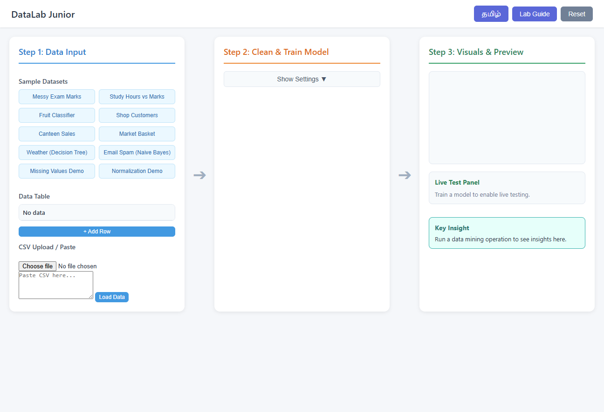
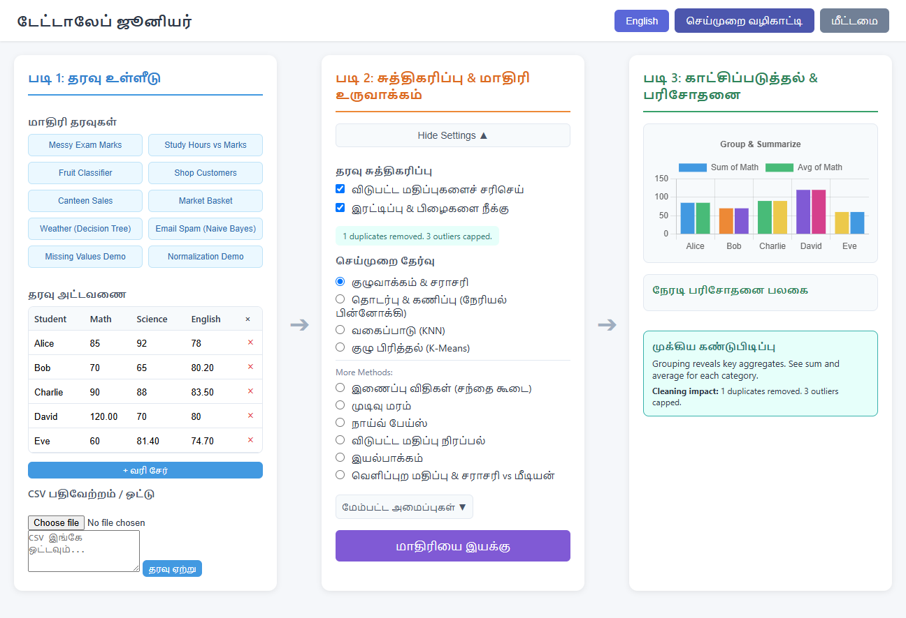
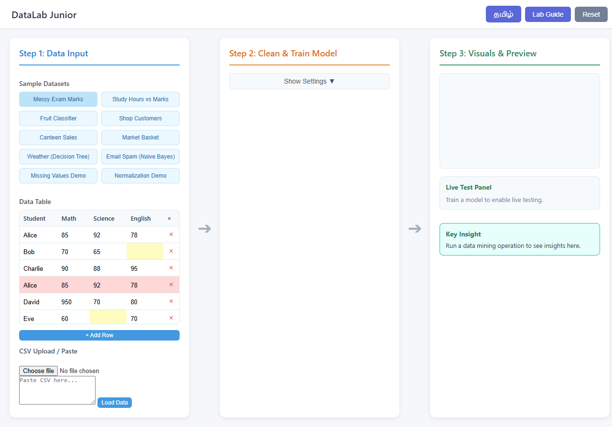
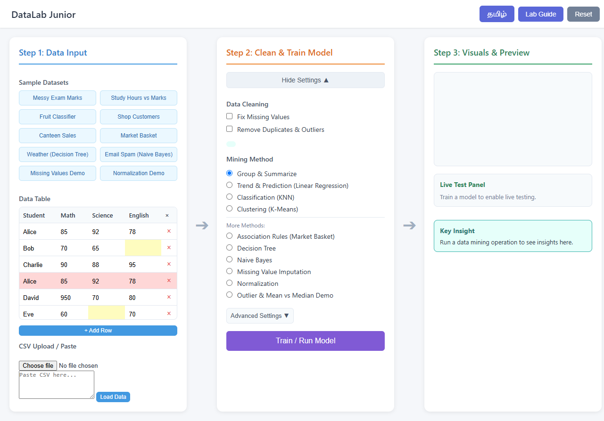
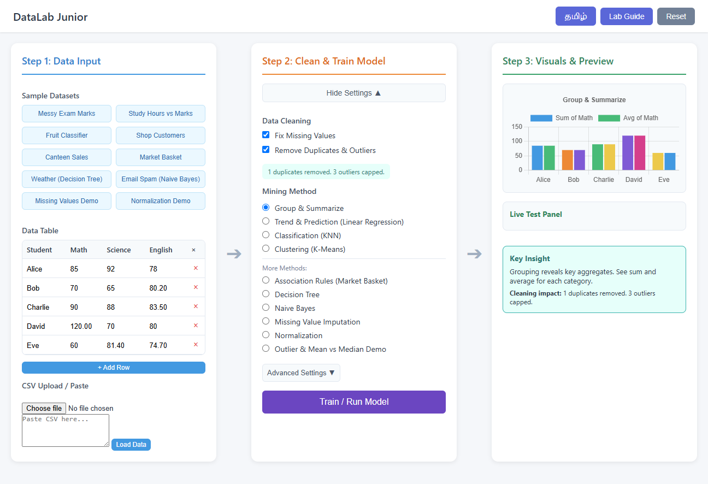
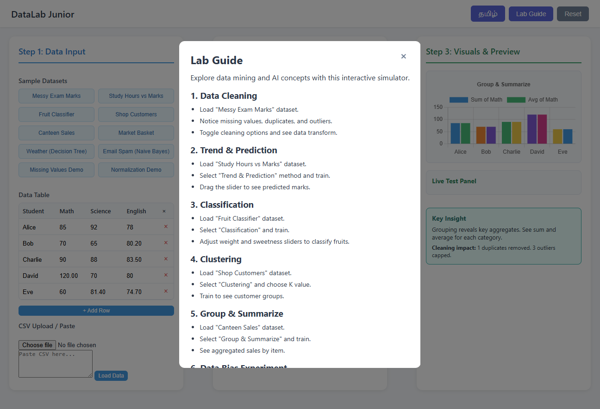

# 📚 DataLab Junior — பயனர் கையேடு (User Guide)

> **தரவு அறிவியல் & டேட்டா மைனிங் சிமுலேட்டர்**  
> பள்ளி மாணவர்களுக்கான இடைமுக கற்றல் கருவி

---

## 📖 அத்தியாயம் 1: அறிமுகம் (Introduction)

### 1.1 DataLab Junior என்றால் என்ன?

**DataLab Junior** என்பது பள்ளி மாணவர்களுக்காக வடிவமைக்கப்பட்ட ஒரு **இடைமுக (Interactive) டேட்டா மைனிங் & டேட்டா சயின்ஸ் சிமுலேட்டர்** ஆகும். இது Google Teachable Machine போன்ற எளிமையான, காட்சி ரீதியான இடைமுகத்தைக் கொண்டுள்ளது.

### 1.2 முக்கிய அம்சங்கள்

- ✅ **100% ஆஃப்லைன்** — எந்த சர்வரும் தேவையில்லை
- ✅ **இருமொழி ஆதரவு** — English & Tamil (தமிழ்)
- ✅ **12 டேட்டா மைனிங் முறைகள்** — ஒரே இடத்தில்
- ✅ **நேரடி காட்சிப்படுத்தல்** — சார்ட்கள், ஸ்லைடர்கள், நம்பிக்கை பார்கள்
- ✅ **டேட்டா சுத்திகரிப்பு** — விடுபட்ட மதிப்புகள், இரட்டிப்புகள், வெளிப்புற மதிப்புகள்
- ✅ **நேரடி கணிப்பு** — ஸ்லைடரை இழுக்கும்போது உடனடி முடிவுகள்

### 1.3 தொழில்நுட்ப அமைப்பு

```
┌─────────────────────────────────────────────────────────┐
│                    DataLab Junior                       │
├─────────────┬──────────────────┬────────────────────────┤
│  HTML5      │  CSS3            │  Vanilla JavaScript    │
│  (Structure)│  (Styling)       │  (Logic & Algorithms)  │
├─────────────┴──────────────────┴────────────────────────┤
│         Chart.js (Charts)  │  PapaParse (CSV)         │
└─────────────────────────────────────────────────────────┘
```

---

## 📖 அத்தியாயம் 2: இடைமுகம் அறிமுகம் (Interface Overview)

### 2.1 முக்கிய திரை (Main Screen)



முக்கிய திரை 3 பகுதிகளாக பிரிக்கப்பட்டுள்ளது:

| பகுதி | பெயர் | பயன்பாடு |
|---|---|---|
| **Card 1 (இடது)** | தரவு உள்ளீடு (Data Input) | டேட்டா ஏற்றுதல், அட்டவணை திருத்தம் |
| **Card 2 (நடு)** | சுத்திகரிப்பு & மாதிரி (Clean & Train) | டேட்டா சுத்திகரிப்பு, முறை தேர்வு, பயிற்சி |
| **Card 3 (வலது)** | காட்சிப்படுத்தல் (Visuals) | சார்ட்கள், நேரடி பரிசோதனை, கண்டுபிடிப்புகள் |

### 2.2 தலைப்பு பட்டை (Header Bar)


| பொத்தான் | பயன்பாடு |
|---|---|
| **தமிழ் / English** | மொழி மாற்றம் (Tamil ↔ English) |
| **Lab Guide** | பயிற்சி வழிகாட்டி மோடல் |
| **Reset** | அனைத்தையும் மீட்டமை |

### 2.3 மொழி மாற்றம் (Language Toggle)



தலைப்பு பட்டையில் உள்ள "தமிழ்" அல்லது "English" பொத்தானை கிளிக் செய்து மொழியை மாற்றலாம். அனைத்து லேபிள்கள், பொத்தான்கள், மற்றும் வழிகாட்டிகள் மாறும்.

---

## 📖 அத்தியாயம் 3: தரவு உள்ளீடு (Data Input)

### 3.1 மாதிரி டேட்டாசெட்கள் (Sample Datasets)



5 மாதிரி டேட்டாசெட்கள் கொடுக்கப்பட்டுள்ளன:

| # | டேட்டாசெட் | விளக்கம் | பயன்பாடு |
|---|---|---|---|
| 1 | **Messy Exam Marks** | விடுபட்ட மதிப்புகள், இரட்டிப்புகள், வெளிப்புற மதிப்பு | சுத்திகரிப்பு பயிற்சி |
| 2 | **Study Hours vs Marks** | படிக்கும் நேரம் & மதிப்பெண் | தொடர்பு & கணிப்பு |
| 3 | **Fruit Classifier** | எடை, இனிப்பு, பழ வகை | வகைப்பாடு |
| 4 | **Shop Customers** | வாங்கிய பொருட்கள், செலவு | குழு பிரித்தல் |
| 5 | **School Canteen Sales** | நாள், பொருள், விற்பனை | குழுவாக்கம் |

### 3.2 டேட்டா அட்டவணை (Data Table)


- **செல் திருத்தம்:** எந்த செல்லையும் கிளிக் செய்து திருத்தலாம்
- **வரி சேர்க்க:** "+ Add Row" பொத்தான்
- **வரி நீக்க:** "×" பொத்தான்
- **அழுக்கு டேட்டா எச்சரிக்கை:**
  - 🟡 மஞ்சள் — விடுபட்ட மதிப்பு (Missing Value)
  - 🔴 சிவப்பு — இரட்டிப்பு வரி (Duplicate Row)
  - 🟠 ஆரஞ்சு — வெளிப்புற மதிப்பு (Outlier)

### 3.3 CSV பதிவேற்றம் (CSV Upload)


1. **கோப்பு பதிவேற்றம்:** "Choose file" → .csv கோப்பை தேர்வு செய்யவும்
2. **ஒட்டுதல்:** டெக்ஸ்ட் ஏரியாவில் CSV டேட்டாவை paste செய்து "Load Data" கிளிக் செய்யவும்

---

## 📖 அத்தியாயம் 4: டேட்டா சுத்திகரிப்பு (Data Cleaning)

### 4.1 சுத்திகரிப்பு தேர்வுகள் (Cleaning Toggles)



| Toggle | செயல்பாடு |
|---|---|
| **Fix Missing Values** | விடுபட்ட எண் மதிப்புகளை காலம் சராசரியால் நிரப்பும் |
| **Remove Duplicates & Outliers** | இரட்டிப்பு வரிகளை நீக்கி, வெளிப்புற மதிப்புகளை IQR முறையில் கட்டுப்படுத்தும் |

### 4.2 சுத்திகரிப்பு நிலை (Cleaning Status)

சுத்திகரிப்பு முடிந்ததும் நிலை பட்டை காட்டும்:
- "2 missing values fixed."
- "1 duplicates removed. 3 outliers capped."
- "No duplicates or outliers found."

---

## 📖 அத்தியாயம் 5: மாதிரி உருவாக்கம் (Model Training)

### 5.1 முறை தேர்வு (Method Selection)


**அடிப்படை முறைகள் (Basic Methods):**

| # | முறை | பயன்பாடு | சார்ட் வகை |
|---|---|---|---|
| 1 | **Group & Summarize** | குழுவாக்கம் & சராசரி | பார் சார்ட் |
| 2 | **Trend & Prediction** | நேரியல் பின்னோக்கி | ஸ்கேட்டர் + கோடு |
| 3 | **Classification (KNN)** | வகைப்பாடு | ஸ்கேட்டர் (நிற குறியீடு) |
| 4 | **Clustering (K-Means)** | குழு பிரித்தல் | ஸ்கேட்டர் (சென்ட்ராய்டுகள்) |

**மேம்பட்ட முறைகள் (Advanced Methods):**

| # | முறை | பயன்பாடு | சார்ட் வகை |
|---|---|---|---|
| 5 | **Association Rules** | சந்தை கூடை பகுப்பாய்வு | பார் சார்ட் (நம்பிக்கை %) |
| 6 | **Decision Tree** | முடிவு மரம் | பார் சார்ட் + மர அமைப்பு |
| 7 | **Naive Bayes** | நிகழ்தகவு வகைப்பாடு | பார் சார்ட் (வகுப்புகள்) |
| 8 | **Missing Value Imputation** | விடுபட்ட மதிப்பு நிரப்பல் | பார் சார்ட் (சராசரி vs மீடியன்) |
| 9 | **Normalization** | இயல்பாக்கம் | ஸ்கேட்டர் (அசல் vs இயல்பாக்கம்) |
| 10 | **Outlier & Mean vs Median** | வெளிப்புற மதிப்பு டெமோ | ஸ்கேட்டர் (கோடுகளுடன்) |

### 5.2 மேம்பட்ட அமைப்புகள் (Advanced Settings)


- **K value for Clustering:** 2, 3, அல்லது 4 குழுக்கள்
- "Advanced Settings ▼" பொத்தானை கிளிக் செய்து விரிவாக்கவும்

### 5.3 பயிற்சி செயல்முறை (Training Process)



1. டேட்டாவை ஏற்றவும்
2. சுத்திகரிப்பு toggle களை தேர்வு செய்யவும் (விருப்பம்)
3. முறையை தேர்வு செய்யவும்
4. "Train / Run Model" கிளிக் செய்யவும்
5. ப்ரோக்ரஸ் பார் அனிமேஷன் முடியும் வரை காத்திருக்கவும்
6. Card 3 இல் முடிவுகள் காட்டப்படும்

---

## 📖 அத்தியாயம் 6: காட்சிப்படுத்தல் & நேரடி பரிசோதனை (Visuals & Live Preview)

### 6.1 டைனமிக் சார்ட் (Dynamic Chart)


சார்ட் தானாகவே தேர்வு செய்யப்பட்ட முறைக்கு ஏற்ற வகையில் மாறும்:
- **Bar Chart** — Group & Summarize, Imputation
- **Scatter Plot + Regression Line** — Trend & Prediction
- **Color-coded Scatter** — Classification, Clustering
- **Scatter + Mean/Median Lines** — Outlier Demo
- **Original vs Normalized** — Normalization

### 6.2 நேரடி பரிசோதனை பலகை (Live Test Panel)


| முறை | ஸ்லைடர்கள் | வெளியீடு |
|---|---|---|
| Trend & Prediction | Study Hours | கணிக்கப்பட்ட மதிப்பெண் |
| Classification | Weight, Sweetness | நம்பிக்கை பார்கள் (%) |
| Clustering | Items Bought, Total Spend | கணிக்கப்பட்ட குழு |
| Naive Bayes | Word1, Word2, Word3 | Classify பட்டன் |

### 6.3 கண்டுபிடிப்பு பெட்டி (Insight Box)


மாதிரி இயக்கியதும் தானாகவே ஒரு கண்டுபிடிப்பு பெட்டி காட்டப்படும்:
- தொடர்பு வகை (Strong positive, Weak, etc.)
- சுத்திகரிப்பு தாக்கம் (Cleaning impact)
- முறை-சார்ந்த விளக்கம்

---

## 📖 அத்தியாயம் 7: பயிற்சி வழிகாட்டி (Lab Guide)

### 7.1 லேப் கைட் மோடல்



தலைப்பு பட்டையில் "Lab Guide" பொத்தானை கிளிக் செய்தால் 12 பயிற்சி தட்டங்கள் கொண்ட வழிகாட்டி திறக்கும்.

### 7.2 பயிற்சி தட்டங்கள் (Lab Exercises)

| # | பயிற்சி | டேட்டாசெட் | முறை |
|---|---|---|---|
| 1 | டேட்டா சுத்திகரிப்பு | Messy Exam Marks | Cleaning Toggles |
| 2 | தொடர்பு & கணிப்பு | Study Hours vs Marks | Trend & Prediction |
| 3 | வகைப்பாடு | Fruit Classifier | Classification |
| 4 | குழு பிரித்தல் | Shop Customers | Clustering |
| 5 | குழுவாக்கம் | Canteen Sales | Group & Summarize |
| 6 | டேட்டா பயாஸ் | எந்த டேட்டாசெட்டும் | வரி நீக்கல் + Classification |
| 7 | இணைப்பு விதிகள் | Market Basket | Association Rules |
| 8 | முடிவு மரம் | Weather | Decision Tree |
| 9 | நாய்வ் பேய்ஸ் | Email Spam | Naive Bayes |
| 10 | விடுபட்ட மதிப்பு நிரப்பல் | Missing Values Demo | Imputation |
| 11 | இயல்பாக்கம் | Normalization Demo | Normalization |
| 12 | வெளிப்புற மதிப்பு டெமோ | Messy Exam Marks | Outlier Demo |

---

## 📖 அத்தியாயம் 8: சொந்த டேட்டா பகுப்பாய்வு (Custom Data Analysis)

### 8.1 CSV பதிவேற்றம் (CSV Upload)


1. Card 1 இல் "CSV Upload / Paste" பகுதிக்கு செல்லவும்
2. "Choose file" மூலம் .csv கோப்பை தேர்வு செய்யவும்
3. அல்லது டெக்ஸ்ட் ஏரியாவில் CSV டேட்டாவை paste செய்து "Load Data" கிளிக் செய்யவும்

### 8.2 CSV வடிவம் (CSV Format)

```csv
Student,Math,Science,English
Arun,85,90,78
Priya,70,65,85
Kumar,95,92,88
```

**விதிகள்:**
- முதல் வரி = ஹெடர் (Column names)
- கமா (,) மூலம் பிரிக்கவும்
- விடுபட்ட மதிப்புகளுக்கு காலி இடம் விடவும்

### 8.3 மாதிரி பயிற்சி தட்டங்கள் (Sample Exercises)

**பயிற்சி A: மாணவர் தேர்வு மதிப்பெண்**
```
Student,Math,Science,English,Computer
Arun,85,90,78,92
Priya,70,65,85,75
Kumar,95,92,88,98
Divya,60,55,70,65
```
→ Trend & Prediction இயக்கி Math vs Science தொடர்பை பார்க்கவும்

**பயிற்சி B: கடை விற்பனை**
```
Day,Product,Quantity,Price,Revenue
Monday,Rice,50,40,2000
Monday,Dal,30,60,1800
Tuesday,Rice,45,40,1800
```
→ Group & Summarize இயக்கி பொருள் வாரியாக வருவாயை பார்க்கவும்

**பயிற்சி C: வானிலை டேட்டா**
```
Day,Temperature,Humidity,Wind,Rain
1,32,80,15,Yes
2,28,65,10,No
3,35,90,20,Yes
```
→ Decision Tree இயக்கி Rain முன்னறிவிப்பை பார்க்கவும்

---

## 📖 அத்தியாயம் 9: தொழில்நுட்ப விவரங்கள் (Technical Details)

### 9.1 பயன்படுத்தியுள்ள தொழில்நுட்பங்கள்

| தொழில்நுட்பம் | பயன்பாடு |
|---|---|
| HTML5 | பக்க அமைப்பு, Canvas, Forms |
| CSS3 | Flexbox, Grid, Animations, Responsive Design |
| Vanilla JavaScript | அனைத்து லாஜிக் & அல்காரிதங்கள் |
| Chart.js 3.7.0 | சார்ட் வரைதல் |
| PapaParse 5.3.0 | CSV பார்சிங் |

### 9.2 அல்காரிதங்கள்

| அல்காரிதம் | விளக்கம் |
|---|---|
| Linear Regression | OLS முறை — சாய்வு, இடைமறிப்பு, r கணக்கீடு |
| KNN | யூக்ளிடியன் தூரம் — K அண்டையிலுள்ள புள்ளிகள் |
| K-Means | சென்ட்ராய்ட் அடிப்படையிலான குழு பிரித்தல் |
| Association Rules | Support & Confidence — Apriori முறை |
| Decision Tree | ID3-style — Categorical splitting |
| Naive Bayes | Bayes' Theorem + Laplace Smoothing |
| IQR Outlier Detection | Q1 - 1.5×IQR, Q3 + 1.5×IQR |
| Min-Max Normalization | [0,1] வரம்பு மாற்றம் |
| Z-Score Normalization | சராசரி 0, நிலையான விலகல் 1 |

### 9.3 கோப்பு புள்ளிவிவரங்கள்

| அளவீடு | மதிப்பு |
|---|---|
| கோப்பு அளவு | ~88 KB |
| வரிகள் | 1,545 |
| டேட்டா மைனிங் முறைகள் | 12 |
| மாதிரி டேட்டாசெட்கள் | 11 |
| ஆதரிக்கப்படும் மொழிகள் | 2 (English, Tamil) |

---

## 📖 அத்தியாயம் 10: குறிப்புகள் & � tips (Tips & Tricks)

### 10.1 சிறந்த நடைமுறைகள் (Best Practices)

1. **எப்போதும் சுத்திகரிக்கவும்** — Messy data இருந்தால் cleaning toggles ஐ இயக்கவும்
2. **சரியான டேட்டாசெட் தேர்வு** — ஒவ்வொரு முறைக்கும் பொருத்தமான டேட்டாசெட் உள்ளது
3. **Advanced Settings பயன்படுத்தவும்** — K value மாற்றி வெவ்வேறு முடிவுகளை பார்க்கவும்
4. **நேரடி பரிசோதனை** — ஸ்லைடர்களை இழுத்து முடிவுகளை பார்க்கவும்
5. **இருமொழி பயன்பாடு** — Tamil/English toggle மூலம் மொழியை மாற்றவும்

### 10.2 பொதுவான பிழைகள் (Common Mistakes)

| பிழை | தீர்வு |
|---|---|
| தவறான டேட்டாசெட் தேர்வு | லேப் கைடில் கூறப்பட்ட டேட்டாசெட்டை பயன்படுத்தவும் |
| CSV பார்சிங் பிழை | ஹெடர் வரி சரியாக இருப்பதை உறுதி செய்யவும் |
| ஸ்லைடர் வேலை செய்யவில்லை | முதலில் "Train / Run Model" கிளிக் செய்யவும் |
| சார்ட் காட்டவில்லை | ப்ரோக்ரஸ் பார் முடியும் வரை காத்திருக்கவும் |

### 10.3 குறிப்புகள் (Quick Tips)

- 🎯 **Ctrl+P** → செட்டிங்ஸ் திறக்க
- 🔄 **Reset** → அனைத்தையும் மீட்டமை
- 📊 **Chart hover** → டூல்டிப் காட்டும்
- 🌐 **Language toggle** → English ↔ Tamil
- 📋 **Lab Guide** → 12 பயிற்சி தட்டங்கள்

---

## 📖 முடிவுரை (Conclusion)

DataLab Junior என்பது பள்ளி மாணவர்களுக்கு டேட்டா மைனிங் & டேட்டா சயின்ஸ் கருத்துக்களை **நடைமுறையில்** கற்றுக்கொள்ள உதவும் ஒரு சக்திவாய்ந்த கருவி. 12 டேட்டா மைனிங் முறைகள், 11 மாதிரி டேட்டாசெட்கள், மற்றும் இருமொழி ஆதரவுடன், இது ஒரு **முழுமையான கற்றல் தளம்** ஆகும்.

### அடுத்த படிகள் (Next Steps)

1. அனைத்து 12 பயிற்சி தட்டங்களை செய்து பார்க்கவும்
2. சொந்த CSV டேட்டாவை பதிவேற்றி பகுப்பாய்வு செய்யவும்
3. வெவ்வேறு முறைகளை ஒப்பிட்டு கற்றுக்கொள்ளவும்
4. டேட்டா பயாஸ் சோதனை செய்து பார்க்கவும்

---

> **© DataLab Junior — Data Mining & AI Simulator**  
> பள்ளி மாணவர்களுக்கான இடைமுக கற்றல் கருவி  
> தொழில்நுட்பம்: HTML5, CSS3, Vanilla JavaScript, Chart.js, PapaParse