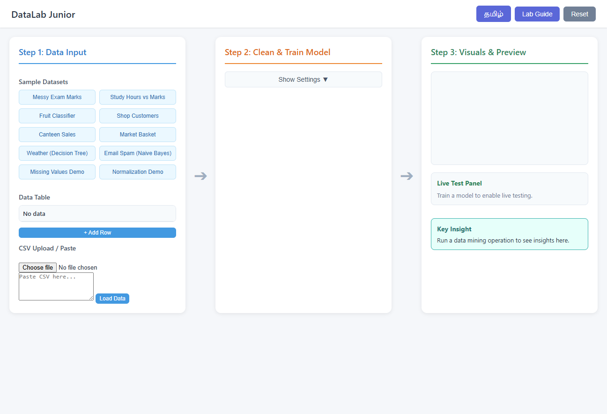
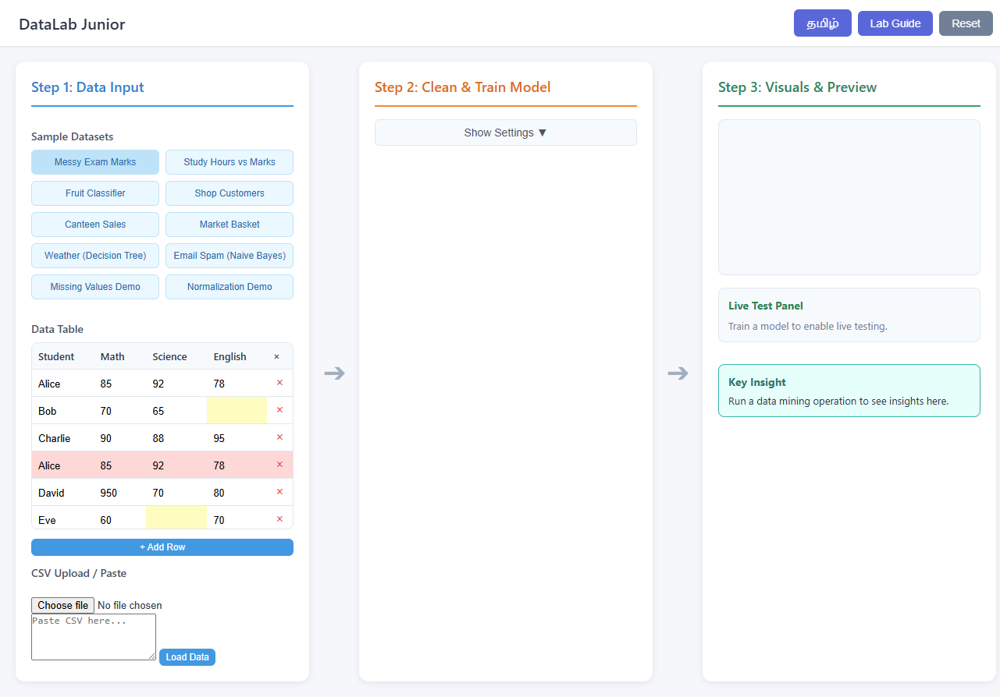
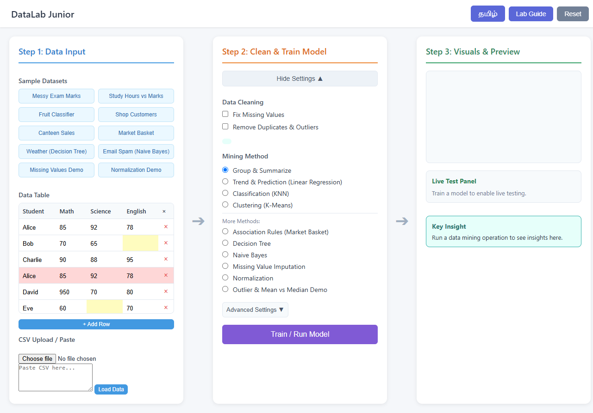
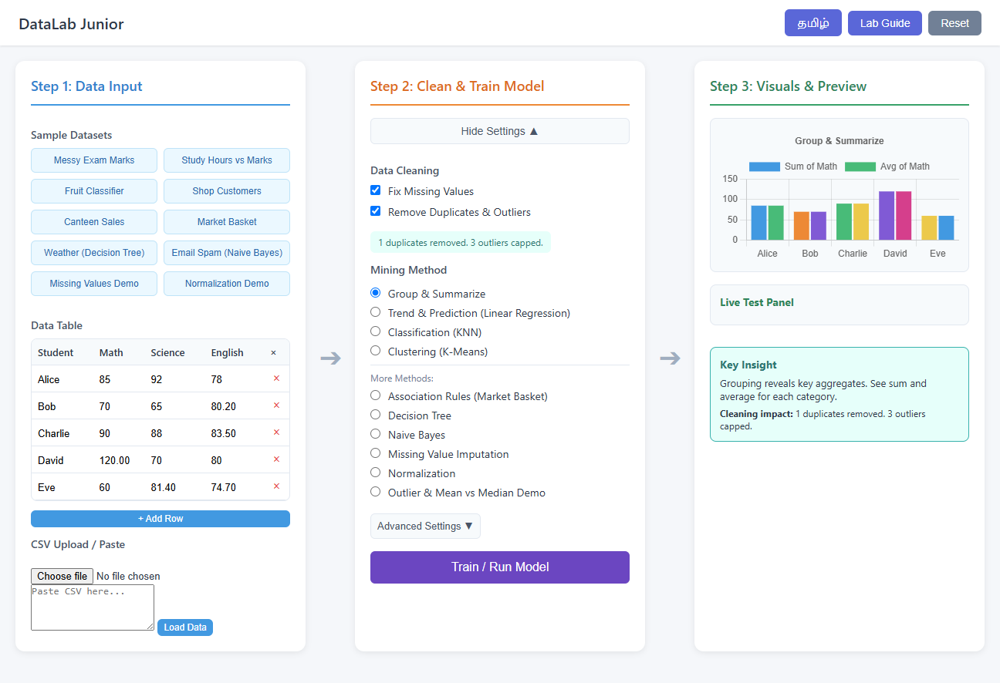
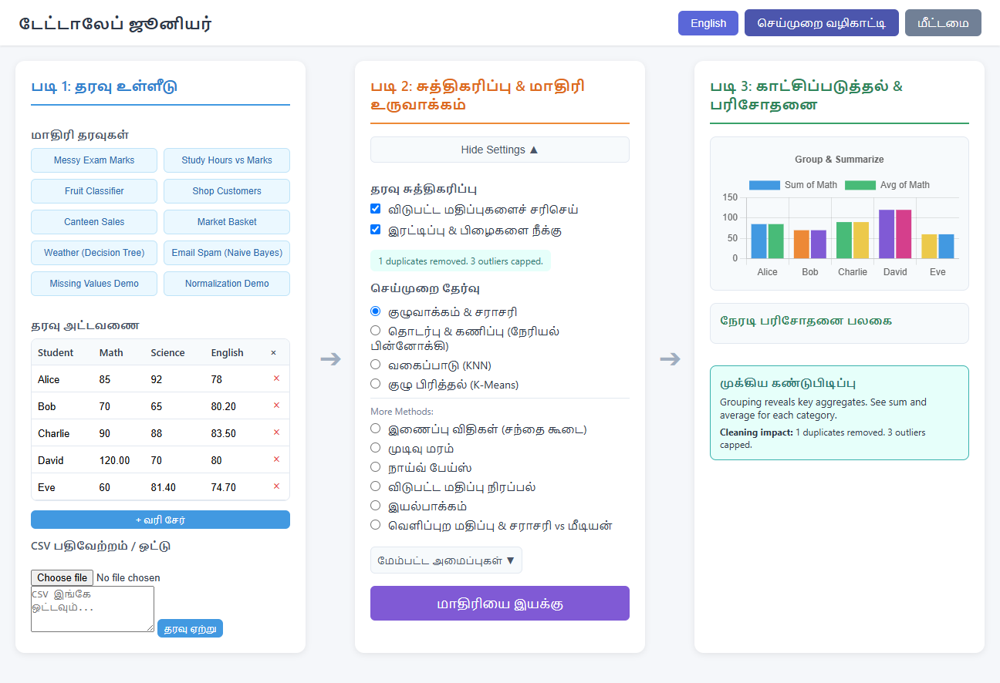
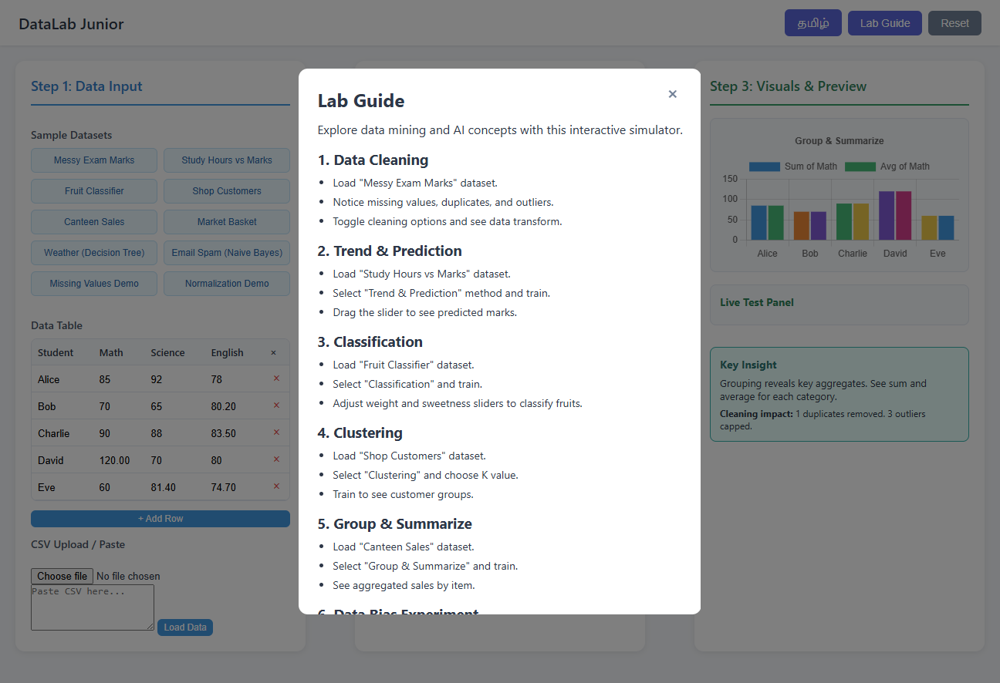

# 🧪 DataLab Junior — Data Mining & AI Simulator

<div align="center">


**பள்ளி மாணவர்களுக்கான இடைமுக டேட்டா மைனிங் & டேட்டா சயின்ஸ் சிமுலேட்டர்**

*Inspired by Google Teachable Machine*

[📖 User Guide](DataLab-Junior-User-Guide.md) • [📝 Lab Exercises](DataLab-Junior-Lab-Exercises.md) • [🚀 Quick Start](#-quick-start)

</div>

---

## 📋 பொருளடக்கம் (Table of Contents)

- [அறிமுகம் (Introduction)](#-அறிமுகம்-introduction)
- [முக்கிய அம்சங்கள் (Features)](#-முக்கிய-அம்சங்கள்-features)
- [தொழில்நுட்பங்கள் (Technologies)](#-தொழில்நுட்பங்கள்-technologies)
- [விரைவு தொடக்கம் (Quick Start)](#-விரைவு-தொடக்கம்-quick-start)
- [டேட்டா மைனிங் முறைகள் (Mining Methods)](#-டேட்டா-மைனிங்-முறைகள்-mining-methods)
- [மாதிரி டேட்டாசெட்கள் (Sample Datasets)](#-மாதிரி-டேட்டாசெட்கள்-sample-datasets)
- [ஆவணங்கள் (Documentation)](#-ஆவணங்கள்-documentation)
- [பயிற்சி தட்டங்கள் (Lab Exercises)](#-பயிற்சி-தட்டங்கள்-lab-exercises)
- [திரை படங்கள் (Screenshots)](#-திரை-படங்கள்-screenshots)
- [பங்களிப்பு (Contributing)](#-பங்களிப்பு-contributing)
- [உரிமம் (License)](#-உரிமம்-license)

---

## 🎯 அறிமுகம் (Introduction)

**DataLab Junior** என்பது பள்ளி மாணவர்களுக்காக வடிவமைக்கப்பட்ட ஒரு **இடைமுக (Interactive) டேட்டா மைனிங் & டேட்டா சயின்ஸ் சிமுலேட்டர்** ஆகும். இது Google Teachable Machine போன்ற எளிமையான, காட்சி ரீதியான இடைமுகத்தைக் கொண்டுள்ளது.

### ஏன் DataLab Junior?

- 🎓 **பள்ளி மாணவர்களுக்காக** — சிக்கலான கருத்துக்களை எளிமையாக புரிந்து கொள்ள
- 🌐 **100% ஆஃப்லைன்** — இணையம் தேவையில்லை
- 🇮🇳 **இருமொழி** — English & Tamil (தமிழ்)
- 📊 **12 டேட்டா மைனிங் முறைகள்** — ஒரே இடத்தில்
- 🎨 **காட்சி ரீதியான** — சார்ட்கள், ஸ்லைடர்கள், நேரடி கணிப்பு

---

## ✨ முக்கிய அம்சங்கள் (Features)

### 🔹 டேட்டா உள்ளீடு (Data Input)
- 11 மாதிரி டேட்டாசெட்கள் (Sample Datasets)
- இடைமுக டேட்டா அட்டவணை (Interactive Data Table)
- CSV கோப்பு பதிவேற்றம் & ஒட்டுதல்
- செல் திருத்தம், வரி சேர்க்க/நீக்க
- அழுக்கு டேட்டா எச்சரிக்கை (Missing, Duplicate, Outlier)

### 🔹 டேட்டா சுத்திகரிப்பு (Data Cleaning)
- விடுபட்ட மதிப்புகள் நிரப்பல் (Mean Imputation)
- இரட்டிப்பு வரிகள் நீக்கல்
- வெளிப்புற மதிப்புகள் கட்டுப்பாடு (IQR Method)
- நேரடி நிலை பட்டை (Live Status Badge)

### 🔹 12 டேட்டா மைனிங் முறைகள்
- Group & Summarize, Trend & Prediction, Classification (KNN)
- Clustering (K-Means), Association Rules, Decision Tree
- Naive Bayes, Missing Value Imputation, Normalization
- Outlier & Mean vs Median Demo

### 🔹 காட்சிப்படுத்தல் (Visualization)
- டைனமிக் சார்ட்கள் (Bar, Scatter, Line)
- நேரடி பரிசோதனை பலகை (Live Test Panel)
- ஸ்லைடர்கள் & நம்பிக்கை பார்கள்
- தானியங்கி கண்டுபிடிப்பு பெட்டி (Auto Insight Box)

### 🔹 இடைமுகம் (UI/UX)
- 3-கார்டு பைப்லைன் லேஅவுட் (Teachable Machine Style)
- சுருக்கக்கூடிய Step 2 பகுதி (Collapsible)
- இருமொழி ஆதரவு (English ↔ Tamil)
- ரெஸ்பான்சிவ் டிசைன் (Responsive Design)
- 12 பயிற்சி தட்டங்கள் (Lab Guide Modal)

---

## 🛠️ தொழில்நுட்பங்கள் (Technologies)

| தொழில்நுட்பம் | பதிப்பு | பயன்பாடு |
|---|---|---|
| HTML5 | — | பக்க அமைப்பு, Canvas, Forms |
| CSS3 | — | Flexbox, Grid, Animations, Responsive |
| Vanilla JavaScript (ES6+) | — | அனைத்து லாஜிக் & அல்காரிதங்கள் |
| Chart.js | 3.7.0 | சார்ட் வரைதல் (CDN) |
| PapaParse | 5.3.0 | CSV பார்சிங் (CDN) |

### கட்டமைப்பு (Architecture)

```
Single HTML File (index.html)
├── <head>
│   ├── CSS Styles (inline)
│   ├── Chart.js (CDN)
│   └── PapaParse (CDN)
├── <body>
│   ├── Header Bar (Title, Lang Toggle, Lab Guide, Reset)
│   ├── 3-Column Pipeline Layout
│   │   ├── Card 1: Data Input
│   │   ├── Card 2: Clean & Train (Collapsible)
│   │   └── Card 3: Visuals & Preview
│   ├── Lab Guide Modal
│   └── <script> (All JavaScript)
│       ├── Global State Variables
│       ├── 11 Sample Datasets
│       ├── Helper Functions
│       ├── Data Cleaning Functions
│       ├── 12 ML Algorithms
│       ├── Chart Rendering
│       ├── Live Preview Setup
│       ├── Insight Generation
│       └── Event Listeners
```

---

## 🚀 விரைவு தொடக்கம் (Quick Start)

### படி 1: டவுன்லோட் (Download)

```bash
git clone https://github.com/your-username/datalab-junior.git
cd datalab-junior
```

### படி 2: திறக்க (Open)

```bash
# எந்த பிரவுசரிலும் திறக்கவும்
open index.html

# அல்லது
start index.html

# அல்லது
python -m http.server 8080
# பின்னர் http://localhost:8080 திறக்கவும்
```

### படி 3: பயன்படுத்த (Use)

1. **மாதிரி டேட்டாசெட்** தேர்வு செய்யவும் (Sample Dataset button)
2. **சுத்திகரிப்பு** toggle களை இயக்கவும் (விருப்பம்)
3. **முறை** தேர்வு செய்யவும் (Method selection)
4. **"Train / Run Model"** கிளிக் செய்யவும்
5. **முடிவுகளை** Card 3 இல் பார்க்கவும்

---

## 📊 டேட்டா மைனிங் முறைகள் (Mining Methods)

### அடிப்படை முறைகள் (Basic Methods)

| # | முறை | பயன்பாடு | சார்ட் வகை |
|---|---|---|---|
| 1 | **Group & Summarize** | குழுவாக்கம் & சராசரி | பார் சார்ட் |
| 2 | **Trend & Prediction** | நேரியல் பின்னோக்கி (Linear Regression) | ஸ்கேட்டர் + கோடு |
| 3 | **Classification (KNN)** | வகைப்பாடு (K-Nearest Neighbors) | ஸ்கேட்டர் (நிற குறியீடு) |
| 4 | **Clustering (K-Means)** | குழு பிரித்தல் | ஸ்கேட்டர் (சென்ட்ராய்டுகள்) |

### மேம்பட்ட முறைகள் (Advanced Methods)

| # | முறை | பயன்பாடு | சார்ட் வகை |
|---|---|---|---|
| 5 | **Association Rules** | சந்தை கூடை பகுப்பாய்வு (Apriori) | பார் சார்ட் (நம்பிக்கை %) |
| 6 | **Decision Tree** | முடிவு மரம் (ID3-style) | பார் சார்ட் + மர அமைப்பு |
| 7 | **Naive Bayes** | நிகழ்தகவு வகைப்பாடு | பார் சார்ட் (வகுப்புகள்) |
| 8 | **Missing Value Imputation** | விடுபட்ட மதிப்பு நிரப்பல் | பார் சார்ட் (Mean vs Median) |
| 9 | **Normalization** | இயல்பாக்கம் (Min-Max, Z-Score) | ஸ்கேட்டர் (அசல் vs இயல்பாக்கம்) |
| 10 | **Outlier & Mean vs Median** | வெளிப்புற மதிப்பு டெமோ | ஸ்கேட்டர் (கோடுகளுடன்) |

---

## 📂 மாதிரி டேட்டாசெட்கள் (Sample Datasets)

| # | டேட்டாசெட் | விளக்கம் | பயன்பாடு |
|---|---|---|---|
| 1 | **Messy Exam Marks** | விடுபட்ட மதிப்புகள், இரட்டிப்புகள், வெளிப்புற மதிப்பு | சுத்திகரிப்பு |
| 2 | **Study Hours vs Marks** | படிக்கும் நேரம் & மதிப்பெண் | தொடர்பு & கணிப்பு |
| 3 | **Fruit Classifier** | எடை, இனிப்பு, பழ வகை | வகைப்பாடு |
| 4 | **Shop Customers** | வாங்கிய பொருட்கள், செலவு | குழு பிரித்தல் |
| 5 | **School Canteen Sales** | நாள், பொருள், விற்பனை | குழுவாக்கம் |
| 6 | **Market Basket** | ட்ரான்சாக்ஷன் டேட்டா | இணைப்பு விதிகள் |
| 7 | **Weather** | வானிலை டேட்டா | முடிவு மரம் |
| 8 | **Email Spam** | சொல் அம்சங்கள் | நாய்வ் பேய்ஸ் |
| 9 | **Missing Values Demo** | விடுபட்ட மதிப்புகள் | இம்புடேஷன் |
| 10 | **Normalization Demo** | வெவ்வேறு அளவுகள் | இயல்பாக்கம் |
| 11 | **Messy Exam Marks (Outlier)** | வெளிப்புற மதிப்பு டெமோ | Outlier Demo |

---

## 📖 ஆவணங்கள் (Documentation)

| ஆவணம் | விளக்கம் | கோப்பு |
|---|---|---|
| **பயனர் கையேடு** | முழுமையான பயன்பாட்டு வழிகாட்டி (10 அத்தியாயங்கள்) | [DataLab-Junior-User-Guide.md](DataLab-Junior-User-Guide.md) |
| **பயிற்சி தட்டங்கள்** | 24 மாதிரி பயிற்சிகள் (ஸ்கிரீன்ஷாட்களுடன்) | [DataLab-Junior-Lab-Exercises.md](DataLab-Junior-Lab-Exercises.md) |
| **README** | இந்த கோப்பு | [README.md](README.md) |

### பயனர் கையேடு (User Guide) — 10 அத்தியாயங்கள்

| அத்தியாயம் | தலைப்பு |
|---|---|
| 1 | அறிமுகம் (Introduction) |
| 2 | இடைமுகம் அறிமுகம் (Interface Overview) |
| 3 | தரவு உள்ளீடு (Data Input) |
| 4 | டேட்டா சுத்திகரிப்பு (Data Cleaning) |
| 5 | மாதிரி உருவாக்கம் (Model Training) |
| 6 | காட்சிப்படுத்தல் (Visuals & Live Preview) |
| 7 | பயிற்சி வழிகாட்டி (Lab Guide) |
| 8 | சொந்த டேட்டா பகுப்பாய்வு (Custom Data Analysis) |
| 9 | தொழில்நுட்ப விவரங்கள் (Technical Details) |
| 10 | குறிப்புகள் & Tips |

---

## 📝 பயிற்சி தட்டங்கள் (Lab Exercises)

### 24 பயிற்சிகள் (24 Exercises)

| பகுதி | பயிற்சிகள் | முறைகள் |
|---|---|---|
| டேட்டா சுத்திகரிப்பு | 3 | Fix Missing, Remove Duplicates/Outliers |
| தொடர்பு & கணிப்பு | 3 | Linear Regression |
| வகைப்பாடு | 4 | KNN Classification |
| குழு பிரித்தல் | 2 | K-Means Clustering |
| குழுவாக்கம் & சுருக்கம் | 2 | Group & Summarize |
| இணைப்பு விதிகள் | 2 | Association Rules |
| முடிவு மரம் | 2 | Decision Tree |
| நாய்வ் பேய்ஸ் | 2 | Naive Bayes |
| இயல்பாக்கம் | 1 | Normalization |
| விடுபட்ட மதிப்பு நிரப்பல் | 1 | Missing Value Imputation |
| வெளிப்புற மதிப்பு டெமோ | 1 | Outlier & Mean vs Median |
| முழுமையான பைப்லைன் | 1 | All Methods |

### பயிற்சி செய்யும் முறை (How to Practice)

```
┌─────────────────────────────────────────────────────┐
│  1. VS Code இல் ஆவணத்தை திறக்கவும்                │
│  2. Preview பார்க்கவும் (Ctrl + Shift + V)         │
│  3. ஒரு பயிற்சியை தேர்வு செய்யவும்               │
│  4. படிகளை ஒவ்வொன்றாக பின்பற்றவும்               │
│  5. index.html ஐ பிரவுசரில் திறந்து செய்யவும்     │
│  6. கேள்விகளுக்கு பதில் கண்டறியவும்              │
└─────────────────────────────────────────────────────┘
```

---

## 📸 திரை படங்கள் (Screenshots)

### முக்கிய திரை (Main Interface)


### டேட்டா ஏற்றப்பட்டது (Data Loaded)


### செட்டிங்ஸ் விரிவாக்கம் (Settings Expanded)


### பயிற்சி முடிவு (Training Result)


### தமிழ் மொழி (Tamil Language)


### லேப் கைட் (Lab Guide)


---

## 📁 கோப்பு அமைப்பு (File Structure)

```
datalab-junior/
├── index.html                          # வெப் ஆப் (88KB)
├── README.md                           # இந்த கோப்பு
├── DataLab-Junior-User-Guide.md        # பயனர் கையேடு (10 அத்தியாயங்கள்)
├── DataLab-Junior-Lab-Exercises.md     # பயிற்சி தட்டங்கள் (24 பயிற்சிகள்)
└── screenshots/
    ├── 01-main-interface.png
    ├── 02-data-loaded.png
    ├── 03-settings-expanded.png
    ├── 04-training-result.png
    ├── 05-tamil-language.png
    └── 06-lab-guide.png
```

---

## 🎯 தொடக்க வழிகாட்டி (Getting Started)

### படி 1: கிளோன் (Clone)

```bash
git clone https://github.com/your-username/datalab-junior.git
cd datalab-junior
```

### படி 2: திறக்க (Open)

```bash
# எந்த பிரவுசரிலும் திறக்கவும்
open index.html

# அல்லது
start index.html

# அல்லது Python server
python -m http.server 8080
# பின்னர் http://localhost:8080 திறக்கவும்
```

### படி 3: பயன்படுத்த (Use)

1. **மாதிரி டேட்டாசெட்** தேர்வு செய்யவும்
2. **சுத்திகரிப்பு** toggle களை இயக்கவும் (விருப்பம்)
3. **முறை** தேர்வு செய்யவும்
4. **"Train / Run Model"** கிளிக் செய்யவும்
5. **முடிவுகளை** Card 3 இல் பார்க்கவும்

---

## 📖 பயனர் கையேடு (User Guide)

முழுமையான பயன்பாட்டு வழிகாட்டிக்கு: **[DataLab-Junior-User-Guide.md](DataLab-Junior-User-Guide.md)**

### அத்தியாயங்கள் (Chapters)

| # | அத்தியாயம் | விளக்கம் |
|---|---|---|
| 1 | அறிமுகம் | தொழில்நுட்ப அமைப்பு, முக்கிய அம்சங்கள் |
| 2 | இடைமுகம் அறிமுகம் | 3-கார்டு லேஅவுட், தலைப்பு பட்டை |
| 3 | தரவு உள்ளீடு | மாதிரி டேட்டாசெட்கள், அட்டவணை, CSV |
| 4 | டேட்டா சுத்திகரிப்பு | Cleaning toggles, நிலை பட்டை |
| 5 | மாதிரி உருவாக்கம் | 12 முறைகள், Advanced Settings |
| 6 | காட்சிப்படுத்தல் | டைனமிக் சார்ட், நேரடி பரிசோதனை |
| 7 | பயிற்சி வழிகாட்டி | 12 பயிற்சி தட்டங்கள் |
| 8 | சொந்த டேட்டா பகுப்பாய்வு | CSV வடிவம், மாதிரி பயிற்சிகள் |
| 9 | தொழில்நுட்ப விவரங்கள் | அல்காரிதங்கள், தொழில்நுட்பங்கள் |
| 10 | குறிப்புகள் & Tips | சிறந்த நடைமுறைகள், பொதுவான பிழைகள் |

---

## 📝 பயிற்சி தட்டங்கள் (Lab Exercises)

24 மாதிரி பயிற்சிகள் மாணவர்களுக்கான நடைமுறை கையேடு: **[DataLab-Junior-Lab-Exercises.md](DataLab-Junior-Lab-Exercises.md)**

### பயிற்சி பகுதிகள் (Exercise Sections)

| பகுதி | பயிற்சிகள் | முறைகள் |
|---|---|---|
| டேட்டா சுத்திகரிப்பு | 3 | Fix Missing, Remove Duplicates/Outliers |
| தொடர்பு & கணிப்பு | 3 | Linear Regression |
| வகைப்பாடு | 4 | KNN Classification |
| குழு பிரித்தல் | 2 | K-Means Clustering |
| குழுவாக்கம் & சுருக்கம் | 2 | Group & Summarize |
| இணைப்பு விதிகள் | 2 | Association Rules |
| முடிவு மரம் | 2 | Decision Tree |
| நாய்வ் பேய்ஸ் | 2 | Naive Bayes |
| இயல்பாக்கம் | 1 | Normalization |
| விடுபட்ட மதிப்பு நிரப்பல் | 1 | Missing Value Imputation |
| வெளிப்புற மதிப்பு டெமோ | 1 | Outlier & Mean vs Median |
| முழுமையான பைப்லைன் | 1 | All Methods |

---

## 🎨 திரை படங்கள் (Screenshots)

### முக்கிய திரை (Main Interface)


### டேட்டா ஏற்றப்பட்டது (Data Loaded)


### செட்டிங்ஸ் விரிவாக்கம் (Settings Expanded)


### பயிற்சி முடிவு (Training Result)


### தமிழ் மொழி (Tamil Language)


### லேப் கைட் (Lab Guide)


---

## 🛠️ தொழில்நுட்ப விவரங்கள் (Technical Details)

### அல்காரிதங்கள் (Algorithms)

| அல்காரிதம் | விளக்கம் |
|---|---|
| Linear Regression | OLS முறை — சாய்வு, இடைமறிப்பு, r கணக்கீடு |
| KNN | யூக்ளிடியன் தூரம் — K அண்டையிலுள்ள புள்ளிகள் |
| K-Means | சென்ட்ராய்ட் அடிப்படையிலான குழு பிரித்தல் |
| Association Rules | Support & Confidence — Apriori முறை |
| Decision Tree | ID3-style — Categorical splitting |
| Naive Bayes | Bayes' Theorem + Laplace Smoothing |
| IQR Outlier Detection | Q1 - 1.5×IQR, Q3 + 1.5×IQR |
| Min-Max Normalization | [0,1] வரம்பு மாற்றம் |
| Z-Score Normalization | சராசரி 0, நிலையான விலகல் 1 |

### கோப்பு புள்ளிவிவரங்கள் (File Stats)

| அளவீடு | மதிப்பு |
|---|---|
| கோப்பு அளவு | ~88 KB |
| வரிகள் | 1,545 |
| டேட்டா மைனிங் முறைகள் | 12 |
| மாதிரி டேட்டாசெட்கள் | 11 |
| ஆதரிக்கப்படும் மொழிகள் | 2 (English, Tamil) |
| வெளி நூலகங்கள் | 2 (Chart.js, PapaParse) |

---

## 🎯 தொடக்க வழிகாட்டி (Getting Started)

### படி 1: கிளோன் (Clone)

```bash
git clone https://github.com/your-username/datalab-junior.git
cd datalab-junior
```

### படி 2: திறக்க (Open)

```bash
# எந்த பிரவுசரிலும் திறக்கவும்
open index.html

# அல்லது
start index.html

# அல்லது Python server
python -m http.server 8080
# பின்னர் http://localhost:8080 திறக்கவும்
```

### படி 3: பயன்படுத்த (Use)

1. **மாதிரி டேட்டாசெட்** தேர்வு செய்யவும்
2. **சுத்திகரிப்பு** toggle களை இயக்கவும் (விருப்பம்)
3. **முறை** தேர்வு செய்யவும்
4. **"Train / Run Model"** கிளிக் செய்யவும்
5. **முடிவுகளை** Card 3 இல் பார்க்கவும்

---

## 🤝 பங்களிப்பு (Contributing)

1. Fork the repository
2. Create your feature branch (`git checkout -b feature/AmazingFeature`)
3. Commit your changes (`git commit -m 'Add some AmazingFeature'`)
4. Push to the branch (`git push origin feature/AmazingFeature`)
5. Open a Pull Request

---

## 📄 உரிமம் (License)

This project is licensed under the MIT License - see the [LICENSE](LICENSE) file for details.

---

## 🙏 நன்றி (Acknowledgments)

- **Google Teachable Machine** — UI/UX உத்வேகம்
- **Chart.js** — சார்ட் வரைதல்
- **PapaParse** — CSV பார்சிங்
- **பள்ளி மாணவர்கள்** — இந்த கருவியின் பயனர்கள்

---

<div align="center">

**Made with ❤️ for School Students**

*DataLab Junior — Data Mining & AI Simulator*

</div>